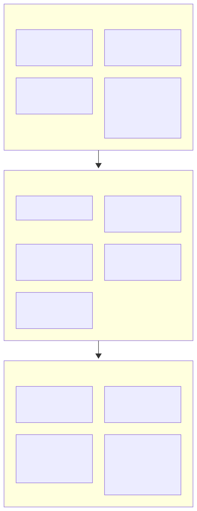
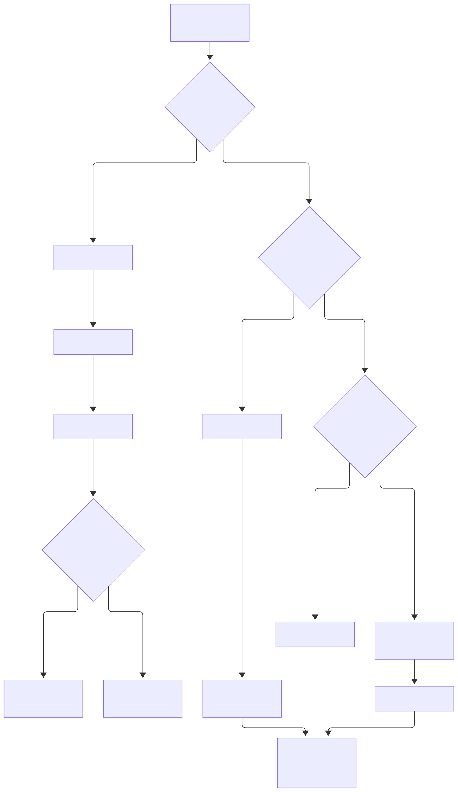

# Proyecto semestral: pipeline OWASP con GitHub Actions

Guía para que el estudiante diseñe, construya y defienda un pipeline de escaneo.
El docente da el marco y los criterios. El estudiante escribe el pipeline,
ejecuta los escaneos y presenta la evidencia.

## Marco OWASP

| Marco | Uso |
|---|---|
| Web Top 10 2021 | Clasificar los hallazgos del escaneo |
| API Security Top 10 2023 | Clasificar los hallazgos sobre OpenAPI |
| Mobile Top 10 2024 | Variante opcional con MobSF |
| CI/CD Top 10 2022 | Auditar el propio pipeline |

## Alcance

- Objetivo: el staging autorizado. Producción solo con alcance firmado.
- Escaneo pasivo en cada cambio propuesto; escaneo activo con aprobación humana.
- Evidencia: fecha UTC, versión del escáner, URL de la ejecución y hash de los reportes.

## Flujo esperado

El trabajo que ejecuta código propuesto no tiene permisos de escritura ni
secretos. El workflow vive en la rama protegida y cambiarlo exige revisión.

## Cobertura de la aplicación

Cada categoría Web A01-A10 y API1-API10 lleva señal observada, categoría OWASP,
evidencia y juicio del estudiante. Si la categoría no es automatizable, se marca
`NO` y se explica la comprobación manual. La variante móvil cubre M1-M10.

## Requisitos del pipeline

| Riesgo | Requisito | Prueba |
|---|---|---|
| CICD-SEC-1 | Separar cambio propuesto y escaneo activo | Flujo y rechazo sin aprobación |
| CICD-SEC-2 | Permisos mínimos, credenciales efímeras | Configuración de permisos |
| CICD-SEC-3 | Versiones fijas y actualizaciones revisadas | Evidencia de fijado |
| CICD-SEC-4 | Código de un cambio sin privilegios | Reglas de rama |
| CICD-SEC-5 | Alcance restringido y entornos separados | Log de un objetivo rechazado |
| CICD-SEC-6 | Búsqueda de secretos | Reporte correspondiente |
| CICD-SEC-7 | Ejecución efímera sin modos privilegiados | Configuración de la ejecución |
| CICD-SEC-8 | Servicios externos inventariados | Lista de servicios usados |
| CICD-SEC-9 | Reportes con hash verificable | Verificación del hash |
| CICD-SEC-10 | Resultado legible y evidencia conservada | Resumen de la ejecución |

## Hitos

| Semanas | Trabajo | Entrega |
|---|---|---|
| 1-3 | Alcance, repositorio y staging | Acta y rama protegida |
| 4-6 | Spec OpenAPI, secretos y escaneo pasivo | Primeros reportes |
| 7-10 | Umbrales, API y matriz OWASP | Hito 1: pipeline de cambio |
| 11-13 | Escaneo activo aprobado y auditoría CI/CD | Matriz de requisitos |
| 14-16 | Evidencia, remediación y defensa | Informe final |

## Entrega y evaluación

El entregable son el pipeline con su historial, tres ejecuciones reales, las
matrices rellenas, el cuaderno de evidencias y dos hallazgos corregidos con su
re-escaneo.

| Criterio | Puntos |
|---|---|
| Marco OWASP y cobertura | 20 |
| Pipeline y flujo controlado | 25 |
| Controles CI/CD | 20 |
| Evidencia y trazabilidad | 20 |
| Defensa y remediación | 15 |
