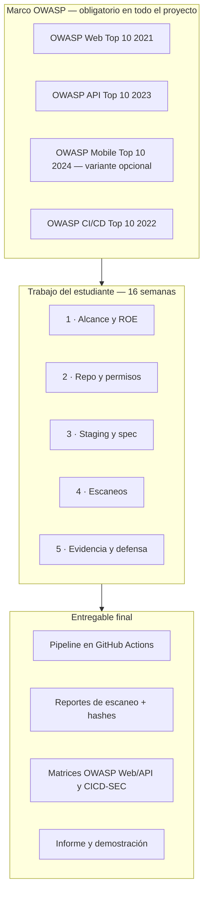
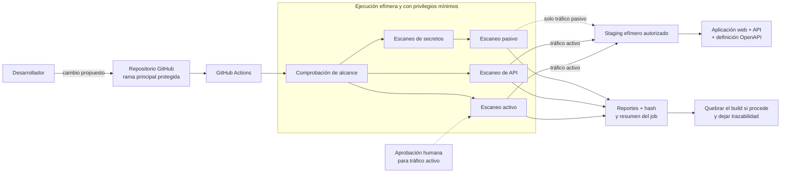
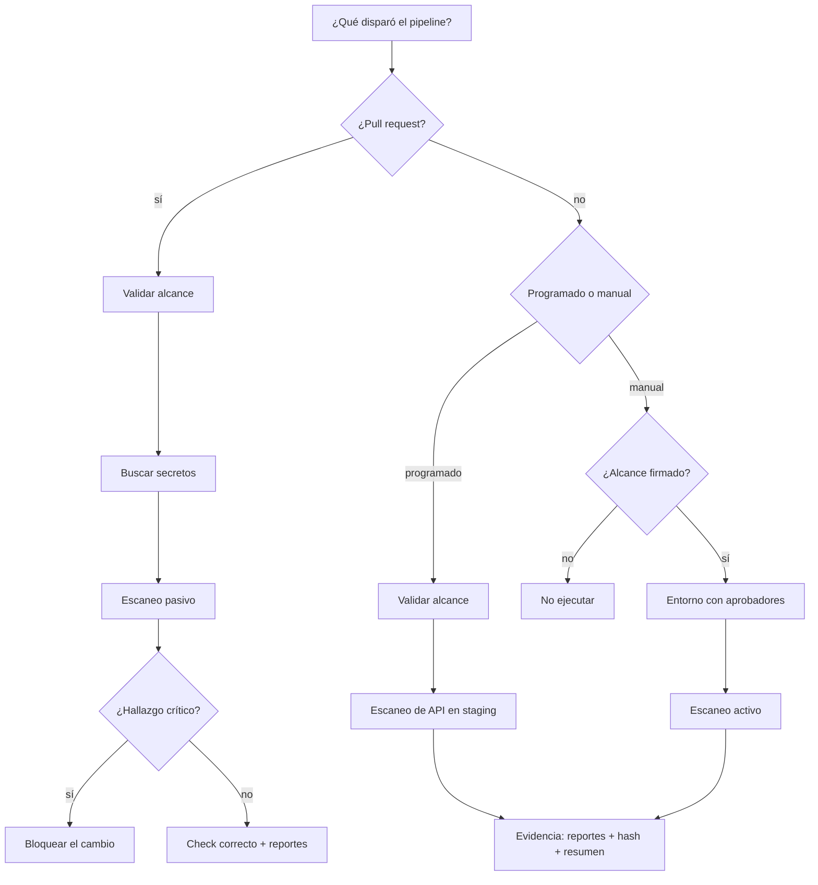
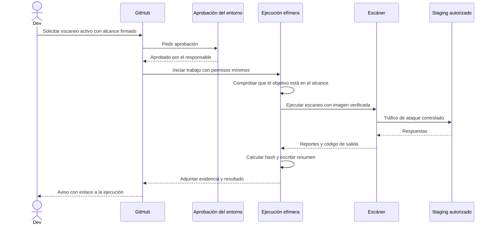

# Proyecto semestral — Pipeline OWASP con GitHub Actions

> **Guía del estudiante.** El docente entrega el marco, los diagramas de lo que
> se espera, los hitos y la rúbrica. El estudiante decide la implementación,
> escribe el pipeline, ejecuta los escaneos y aporta la evidencia. Aquí no hay
> workflow ni configuraciones resueltas: eso es el trabajo.

## 1. Lo que espero

La expectativa es una cadena completa: **marco OWASP → decisiones de diseño →
pipeline ejecutándose → evidencia que demuestra por qué el pipeline es seguro**.
Un workflow que escanea pero no está alineado con OWASP, o una matriz OWASP sin
un run real detrás, no cierra el proyecto.

## 2. Marco OWASP aplicado

| Marco | Para qué sirve en el proyecto | Dónde se entrega |
|---|---|---|
| OWASP Top 10 Web 2021 | Clasificar hallazgos del escaneo pasivo y activo | Matriz de la sección 7 |
| OWASP API Security Top 10 2023 | Clasificar hallazgos del escaneo sobre OpenAPI | Matriz de la sección 7 |
| OWASP Mobile Top 10 2024 | Variante opcional con MobSF (M1-M10) | Matriz M1-M10 |
| OWASP Top 10 CI/CD Risks 2022 | Diseñar y auditar el propio pipeline | Matriz de la sección 8 |

Material base del curso: labs [17](../labs/17-gitleaks.md),
[18](../labs/18-trivy.md) y [19](../labs/19-zap.md), y el
[vocabulario CICD-SEC](../labs/ANEXO-metodo-red-team.md#31-vocabulario-owasp-cicd).
El laboratorio corre en local con Gitea Actions; este proyecto traslada las
mismas ideas a GitHub Actions real.

## 3. Alcance y reglas de enfrentamiento

Antes de escribir código, el equipo entrega por escrito:

- Superficie elegida: **web + API** con OpenAPI (o la variante móvil).
- Activo autorizado, ventana de pruebas y quién aprueba un escaneo activo.
- Prohibición explícita de escanear producción sin alcance firmado.
- Límite de impacto: sin DoS, sin exfiltración, sin datos reales de clientes.
- Formato de evidencia: fecha UTC, versión de la herramienta, URL del run y
  hash de los reportes.

La forma de hacer cumplir el alcance dentro del pipeline es decisión del
estudiante, pero debe ser verificable en los logs.

## 4. Arquitectura esperada

Este diagrama describe el **diseño**, no una implementación. Cada equipo decide
cómo materializarlo.

## 5. Flujo esperado

**Restricción de diseño:** el trabajo que ejecuta código propuesto en una PR no
debe tener permisos de escritura ni secretos. El workflow debe vivir en la rama
protegida y su modificación debe exigir revisión.

## 6. Secuencia esperada del escaneo activo

## 7. Lo que debe demostrar sobre la aplicación

No basta con decir "ZAP pasó". Cada categoría debe tener una entrada en la
matriz: señal observada, categoría OWASP, evidencia y juicio del estudiante.
Marca `NO` cuando la categoría no sea automatizable y explica cómo la comprobaste
a mano.

### 7.1 OWASP Web Top 10 2021

| Categoría | Qué se espera demostrar |
|---|---|
| A01 Broken Access Control | Control de acceso a objetos y funciones; probar con dos identidades |
| A02 Cryptographic Failures | Transporte, cookies y cabeceras de caché |
| A03 Injection | Inyección (SQL, comandos, XSS) con payload y respuesta |
| A04 Insecure Design | Decisiones de diseño que no cubre un escaner; threat model breve |
| A05 Security Misconfiguration | Cabeceras, errores verbosos, información de versión |
| A06 Vulnerable Components | Dependencias y contenedores con SCA, no solo DAST |
| A07 Auth Failures | Gestión de sesiones, tokens y enumeración de usuarios |
| A08 Integrity Failures | Verificación de artefactos y de la imagen del escáner |
| A09 Logging Failures | Trazabilidad de la ejecución del pipeline |
| A10 SSRF | Comportamiento ante URLs controladas por el usuario |

### 7.2 OWASP API Security Top 10 2023

| Categoría | Qué se espera demostrar |
|---|---|
| API1 Broken Object Level Auth | Un usuario no accede a objetos de otro |
| API2 Broken Authentication | Tokens, expiración y credenciales débiles |
| API3 Broken Object Property Level Auth | Campos devueltos que la spec no autoriza |
| API4 Unrestricted Resource Consumption | Límites de tasa y tamaño, probados de forma controlada |
| API5 Broken Function Level Auth | Verbos y rutas no documentados |
| API6 Business Flows | Abuso de flujos legítimos (análisis manual) |
| API7 SSRF | El servidor no puede alcanzar hosts internos |
| API8 Security Misconfiguration | Configuración, errores y spec desactualizada |
| API9 Improper Inventory | Rutas desplegadas frente a rutas documentadas |
| API10 Unsafe Consumption | Llamadas salientes del pipeline a hosts no controlados |

### 7.3 Variante móvil — OWASP Mobile Top 10 2024

Si se elige la variante móvil, la matriz cubre M1 (credenciales), M2 (supply
chain), M3 (autenticación), M4 (validación de entrada/salida), M5 (comunicación),
M6 (privacidad), M7 (protección del binario), M8 (configuración), M9
(almacenamiento) y M10 (criptografía), con MobSF u otra herramienta justificada.

## 8. Criterios que debe cumplir el pipeline (OWASP CI/CD Top 10)

Cada fila es un requisito. El estudiante decide la implementación y aporta la
prueba de que se cumple.

| Riesgo | Requisito | Prueba esperada |
|---|---|---|
| CICD-SEC-1 Flow Control | Separar el cambio propuesto del escaneo activo; intervención humana antes del tráfico ofensivo | Captura del flujo y de un intento rechazado |
| CICD-SEC-2 IAM | Permisos mínimos y credenciales efímeras; sin tokens personales | Configuración de permisos y listado de secretos |
| CICD-SEC-3 Dependency Chain | Versiones fijas de acciones e imágenes; actualizaciones revisadas | Evidencia de fijado y de la política de actualización |
| CICD-SEC-4 Poisoned Pipeline | El código de una PR no se ejecuta con privilegios; workflow protegido | Reglas de rama y revisión del workflow |
| CICD-SEC-5 PBAC | Alcance restringido, entornos separados, artefactos con caducidad | Log del rechazo de un objetivo fuera de alcance |
| CICD-SEC-6 Credential Hygiene | Búsqueda de secretos en el código y ningún secreto en el pipeline | Reporte del escaneo de secretos |
| CICD-SEC-7 System Configuration | Entorno efímero, sin montajes ni modos privilegiados | Configuración de la ejecución |
| CICD-SEC-8 3rd Party Services | Servicios externos inventariados y justificados | Lista de acciones y servicios usados |
| CICD-SEC-9 Artifact Integrity | Reportes con hash y origen verificable | Verificación del hash |
| CICD-SEC-10 Logging | Resultado legible en el job y conservación limitada de evidencia | Resumen de la ejecución y artefactos |

## 9. Hitos de 16 semanas

| Semana | Tema | Trabajo del estudiante | Hito |
|---|---|---|---|
| 1 | Los cuatro marcos OWASP | Elegir superficie; redactar alcance y ROE | Acta de alcance |
| 2 | CICD-SEC-1, 2, 4 | Crear repo, proteger rama, definir revisiones | Rama protegida |
| 3 | CICD-SEC-5, 7 | Preparar staging efímero y comprobar salud | Objetivo disponible |
| 4 | API9 | Publicar definición OpenAPI versionada | Spec validada |
| 5 | CICD-SEC-3, 6 | Diseñar el esqueleto del pipeline y el escaneo de secretos | PR de secretos |
| 6 | Web A01-A10 | Primer escaneo pasivo | Reporte inicial |
| 7 | A02/A05/API8 | Definir umbrales y excepciones justificadas | Tabla de decisión |
| 8 | CICD-SEC-1, 10 | Consolidar el flujo de PR y su trazabilidad | **Hito 1: pipeline de PR** |
| 9 | API1-API10 | Escaneo de API sobre la spec | Reporte de API |
| 10 | Cobertura OWASP | Completar matrices de la sección 7 | Matriz Web + API |
| 11 | CICD-SEC-1, 5 | Habilitar aprobación y ejecutar escaneo activo | Acta + ejecución |
| 12 | CICD-SEC-1 a 5 | Auditar los cinco primeros requisitos | Matriz 1-5 |
| 13 | CICD-SEC-6 a 10 | Auditar los cinco últimos requisitos | Matriz 6-10 |
| 14 | A09 / CICD-SEC-10 | Cuaderno de evidencias con hashes y fechas | Evidencia completa |
| 15 | Remediación | Corregir dos hallazgos y repetir el escaneo | Antes/después |
| 16 | Defensa | Presentar el pipeline y el razonamiento | **Informe final** |

## 10. Pautas, no recetas

El estudiante debe decidir y justificar:

- Qué evento dispara cada tipo de escaneo y con qué frecuencia.
- Cómo se declara el objetivo y cómo se impide que sea un host arbitrario.
- Qué credenciales existen, su ámbito y su duración.
- Cómo se aprueba el tráfico activo y quién puede hacerlo.
- Cómo se fijan las versiones de dependencias y del escáner.
- Cómo se guarda, se comprueba y se caduca la evidencia.
- Qué criterios hacen que un hallazgo rompa la ejecución.

## 11. Entregable final

1. Repositorio con el pipeline y su configuración, con historial de cambios.
2. Ejecuciones reales: escaneo de PR, de API y activo aprobado.
3. Matrices de las secciones 7 y 8 rellenas con evidencia.
4. Cuaderno de evidencias con fecha UTC, versión del escáner, URL del run y
   hash de reportes.
5. Informe con dos hallazgos remedidos y su re-escaneo.
6. Demostración en vivo del pipeline y explicación de los diez requisitos CI/CD.

## 12. Rúbrica (100 puntos)

| Criterio | Puntos | Qué se mira |
|---|---|---|
| Marco OWASP y cobertura Web/API | 20 | Matrices completas; límites del DAST reconocidos |
| Pipeline y flujo controlado | 25 | Separación de fases, alcance verificado, evidencia generada |
| Controles CICD-SEC-1..10 | 20 | Diez requisitos cumplidos con prueba verificable |
| Evidencia y trazabilidad | 20 | Reportes, hashes, fechas, versión y URL del run |
| Defensa y remediación | 15 | Dos hallazgos corregidos y re-escaneados con antes/después |

## 13. Checklist de cierre

- [ ] El alcance está por escrito y se aplica en el pipeline.
- [ ] No hay tokens personales ni permisos sobrantes.
- [ ] Versiones fijas de acciones y del escáner.
- [ ] El tráfico activo requiere aprobación humana.
- [ ] Reportes con hash verificable y caducidad definida.
- [ ] Matrices OWASP y CICD-SEC basadas en ejecuciones reales.
- [ ] Hallazgos remediados y verificados de nuevo.
